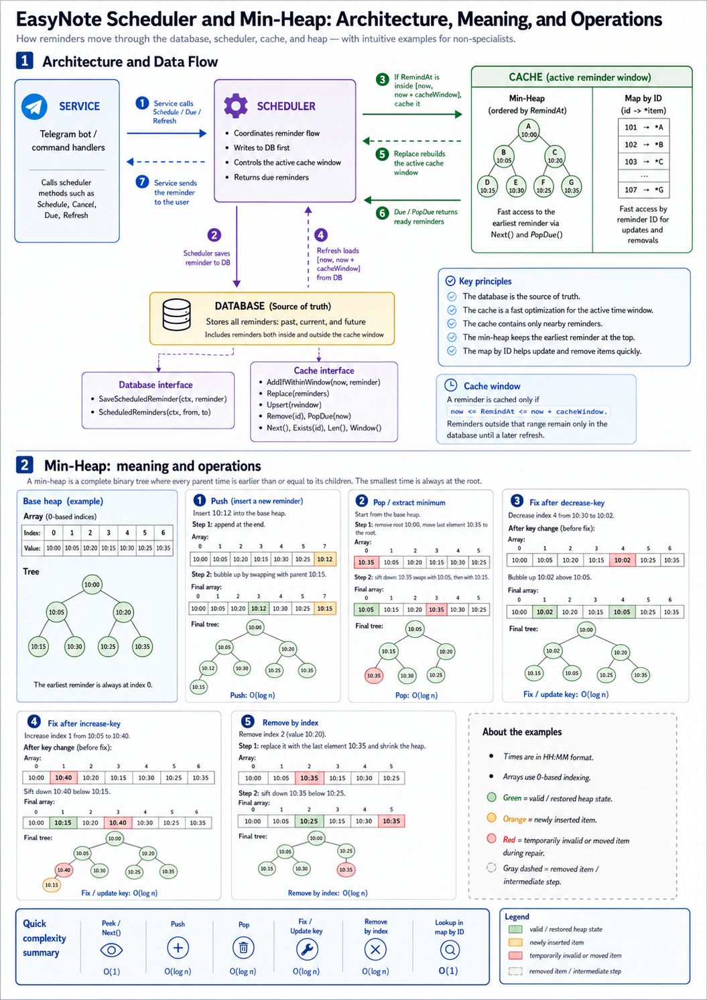

# EasyNote

Telegram reminder bot for routine tasks.

## Version

The source of truth for the application version is `CHANGELIST.md`.

Current version: `0.4.0`.

## Tests

Focused verification commands:

```bash
go test ./src/scheduler ./src/database/cache ./src/database ./src/config -cover
golangci-lint run ./src/scheduler ./src/database/cache ./src/database ./src/config
```

### Package `src/scheduler`

The scheduler tests prove the service-facing reminder planning contract. The scheduler is the layer above the database and cache implementations:

- `scheduler.Database` is the source of truth.
- `scheduler.Cache` is an optimization for the active reminder window.
- `github.com/benbjohnson/clock` is used so time-dependent behavior can be tested deterministically.

Scheduling behavior:

- Every new reminder is saved through `Database.SaveScheduledReminder`.
- If the reminder belongs to the current cache window, it is also inserted into cache.
- If the reminder is outside the cache window, it stays only in the database.
- `Refresh` loads the `[now, now + cacheWindow]` database window and replaces the cache contents.

The package tests prove that contract with real cache, generated gomock database/cache interfaces, and controlled time from `github.com/benbjohnson/clock`.

| Scenario | What is verified | Test type | Status |
|---|---|---|---|
| Schedule inside cache window | Reminder is saved to DB and inserted into real cache | table-driven, real cache, mock DB | PASS |
| Schedule outside cache window | Reminder is saved to DB but not cached | table-driven, real cache, mock DB | PASS |
| Schedule at time boundaries | Current-time and exact-window reminders are accepted | table-driven, real cache, mock DB | PASS |
| Schedule save failure | Database save error is wrapped and cache stays unchanged | table-driven, mock DB | PASS |
| Due reminders | Due reminders are drained according to controlled clock time | table-driven, real cache | PASS |
| Refresh database window | `[now, now + cacheWindow]` is requested from DB | table-driven, mock DB, real cache | PASS |
| Refresh cache replacement | Stale cache entries are removed after refresh | table-driven, mock DB, real cache | PASS |
| Cache delegation | Scheduler delegates due/cancel/delay/window/len calls to cache | table-driven, mock cache | PASS |
| Load 1,000 reminders | Scheduler stores and drains 1,000 reminders | table-driven, real cache, mock DB | PASS |
| Load 10,000 reminders | Scheduler stores and drains 10,000 reminders | table-driven, real cache, mock DB | PASS |
| Concurrent 800 schedules | Scheduler accepts 800 parallel scheduling calls | table-driven, real cache, mock DB | PASS |
| Concurrent 900 schedules | Scheduler accepts 900 parallel scheduling calls | table-driven, real cache, mock DB | PASS |

Coverage: `100.0%`.

Scheduler load benchmark:

```bash
go test ./src/scheduler -run '^$' -bench BenchmarkSchedulerScheduleAndDrainWithRealCache -benchtime=3x -benchmem
```

| Benchmark | Latest local result |
|---|---:|
| `BenchmarkSchedulerScheduleAndDrainWithRealCache` | `~19.2 ms/op`, `~6.9 MB/op`, `~50160 allocs/op` |

### Package `src/database/cache`

The cache tests verify the heap-backed reminder storage that scheduler uses as an optimization layer.

| Scenario | What is verified | Test type | Status |
|---|---|---|---|
| Scheduled reminder conversion | Note and reminder fields are copied into scheduled reminder DTO | table-driven, real types | PASS |
| Heap operations | Push, pop, swap, ordering, and heap indexes work correctly | table-driven, real heap | PASS |
| Add within cache window | Only reminders inside the current window are inserted | table-driven, real cache | PASS |
| Upsert | Existing reminders are updated without duplicates | table-driven, real cache | PASS |
| Pop due | Due reminders are drained and future reminders stay cached | table-driven, real cache | PASS |
| Remove | Existing reminders are removed and missing reminders are ignored | table-driven, real cache | PASS |
| Empty state | Empty cache operations remain stable | table-driven, real cache | PASS |

Coverage: `90.3%`.

### Packages `src/database` and `src/config`

These packages are included in the focused command because scheduler and cache depend on their contracts.

| Package | Current focused status |
|---|---|
| `src/database` | no test files |
| `src/config` | no package-specific tests in this focused run |

## Architecture

EasyNote follows a thin clean-architecture style around the reminder flow:

- `service` owns the use case and talks to `scheduler`.
- `scheduler` coordinates reminder persistence, cache refresh, and due reminder extraction.
- `database` is the source of truth for reminders and note data.
- `database/cache` keeps the in-memory heap as a windowed optimization layer.
- `main` wires concrete implementations into the scheduler and service layers.

Data flow:

1. `service` receives a user action from the Telegram bot.
2. `scheduler` persists the reminder through the database interface.
3. If the reminder fits the active cache window, `scheduler` also inserts it into cache.
4. `Refresh` reloads the current window from the database and replaces cache contents.
5. `Due` drains ready reminders from cache for delivery by the service layer.

The design keeps business rules above storage details and lets the cache stay disposable.

### Cache in practice



The cache is not the source of truth. It is a narrow, fast layer that keeps only the reminders that are close enough to matter right now.

What happens in practice:

1. The service asks the scheduler to store a reminder.
2. The scheduler always writes the reminder to the database first.
3. The scheduler then checks the active cache window.
4. If the reminder fits the window, it is added to the heap-backed cache.
5. If the reminder is outside the window, cache skips it and the database keeps it for later refresh.
6. When the clock reaches the due time, `Due()` pops the top of the heap and returns ready reminders.
7. When the service or background loop calls `Refresh()`, the scheduler reloads the current `[now, now + cacheWindow]` range from the database and replaces cache contents.

Heap behavior:

- `Add` inserts a reminder and keeps the earliest item at the top.
- `Upsert` updates an existing reminder without creating duplicates.
- `PopDue` removes every reminder whose time is now or earlier.
- `Remove` deletes one reminder by id.
- `Replace` throws away stale cache content and rebuilds the active window from the database.

This is why the heap can be very small while the database can keep the full reminder history.

## Changelist

<div style="max-height: 420px; overflow-y: auto; border: 1px solid #d0d7de; border-radius: 6px; padding: 16px;">
<p><strong>version: 0.4.0</strong></p>

<h2>v0.4.0 - scheduler uses database as source of truth</h2>
<ul>
  <li>Scheduler persists reminders through the Database interface before caching.</li>
  <li>Cache refresh now replaces the active reminder window.</li>
  <li>Scheduler tests cover real cache behavior, mock database behavior, mock cache delegation, and load scenarios.</li>
</ul>

<h2>v0.3.0 - added pull request CI and versioned build artifacts</h2>
<ul>
  <li>GitHub Actions CI was added for pull requests.</li>
  <li>Build artifacts and Docker image tags use the changelist version.</li>
</ul>

<h2>v0.2.0 - added reminder cache and repository quality checks</h2>
<ul>
  <li>Reminder cache, heap scheduling primitives, migrations, and strict golangci-lint configuration were added.</li>
</ul>

<h2>v0.1.0 - created base application structure</h2>
<ul>
  <li>Initial Go module, configuration, logger, and reminder cache were added.</li>
</ul>
</div>
