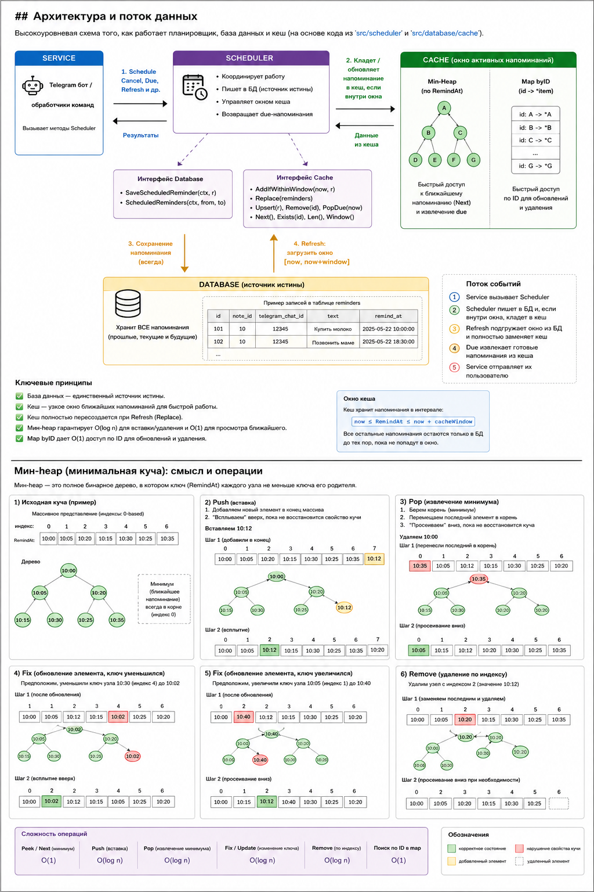

# EasyNote

Telegram-бот для напоминаний о рутинных задачах.

## Версия

Источник версии приложения - `CHANGELIST.md`.

Текущая версия: `1.0.0`.

## Тесты

Команды для focused-проверки:

```bash
go test ./src/scheduler ./src/database/cache ./src/database ./src/config -cover
golangci-lint run ./src/scheduler ./src/database/cache ./src/database ./src/config
```

Проверки для деплоя:

```bash
go test ./src/config ./src/telegram -count=1
golangci-lint run --config ./.golangci.yml ./src/config
docker build --check -f deploy/docker/EasyNote.Dockerfile .
```

### Пакет `src/scheduler`

Тесты планировщика проверяют контракт слоя service. Планировщик находится над слоем базы данных и cache и не зависит от конкретной реализации:

- `scheduler.Database` является источником истины.
- `scheduler.Cache` используется как оптимизация для активного окна напоминаний.
- `github.com/benbjohnson/clock` используется, чтобы управлять временем в тестах.

Поведение:

- новое напоминание всегда сохраняется через `Database.SaveScheduledReminder`;
- если напоминание попадает в текущее окно cache, оно дополнительно кладется в cache;
- если напоминание выходит за пределы окна cache, оно остается только в базе;
- `Refresh` загружает окно `[now, now + cacheWindow]` из базы и полностью заменяет содержимое cache.

Тесты проверяют этот контракт через реальный cache, сгенерированные gomock-интерфейсы базы/cache и управляемое время через `github.com/benbjohnson/clock`.

| Сценарий | Что проверяется | Тип теста | Статус |
|---|---|---|---|
| Schedule внутри cache window | Напоминание сохраняется в БД и попадает в реальный cache | table-driven, real cache, mock DB | PASS |
| Schedule вне cache window | Напоминание сохраняется в БД, но не попадает в cache | table-driven, real cache, mock DB | PASS |
| Schedule на границах времени | Текущий момент и точная граница окна принимаются | table-driven, real cache, mock DB | PASS |
| Ошибка сохранения | Ошибка БД оборачивается, cache не меняется | table-driven, mock DB | PASS |
| Due reminders | Готовые напоминания извлекаются по управляемому clock | table-driven, real cache | PASS |
| Refresh окна БД | Из БД запрашивается `[now, now + cacheWindow]` | table-driven, mock DB, real cache | PASS |
| Refresh заменяет cache | Старые элементы cache удаляются после refresh | table-driven, mock DB, real cache | PASS |
| Делегирование в cache | Scheduler вызывает due/cancel/delay/window/len у cache | table-driven, mock cache | PASS |
| 1 000 напоминаний | Scheduler сохраняет и извлекает 1 000 напоминаний | table-driven, real cache, mock DB | PASS |
| 10 000 напоминаний | Scheduler сохраняет и извлекает 10 000 напоминаний | table-driven, real cache, mock DB | PASS |
| 800 параллельных schedule | Scheduler принимает 800 параллельных вызовов планирования | table-driven, real cache, mock DB | PASS |
| 900 параллельных schedule | Scheduler принимает 900 параллельных вызовов планирования | table-driven, real cache, mock DB | PASS |

Покрытие: `100.0%`.

Нагрузочный benchmark планировщика:

```bash
go test ./src/scheduler -run '^$' -bench BenchmarkSchedulerScheduleAndDrainWithRealCache -benchtime=3x -benchmem
```

| Benchmark | Последний локальный результат |
|---|---:|
| `BenchmarkSchedulerScheduleAndDrainWithRealCache` | `~19.2 ms/op`, `~6.9 MB/op`, `~50160 allocs/op` |

### Пакет `src/database/cache`

Тесты cache проверяют heap-хранилище напоминаний, которое планировщик использует как оптимизационный слой.

| Сценарий | Что проверяется | Тип теста | Статус |
|---|---|---|---|
| Конвертация scheduled reminder | Поля note и reminder копируются в DTO планировщика | table-driven, real types | PASS |
| Heap operations | Push, pop, swap, ordering и heap indexes работают корректно | table-driven, real heap | PASS |
| Add within cache window | Только напоминания внутри текущего окна попадают в cache | table-driven, real cache | PASS |
| Upsert | Существующие напоминания обновляются без дублей | table-driven, real cache | PASS |
| Pop due | Готовые напоминания извлекаются, будущие остаются в cache | table-driven, real cache | PASS |
| Remove | Существующие напоминания удаляются, отсутствующие игнорируются | table-driven, real cache | PASS |
| Empty state | Операции над пустым cache остаются стабильными | table-driven, real cache | PASS |

Покрытие: `90.3%`.

### Пакеты `src/database` и `src/config`

Эти пакеты включены в focused-команду, потому что scheduler и cache зависят от их контрактов.

| Пакет | Текущий focused-статус |
|---|---|
| `src/database` | нет тестовых файлов |
| `src/config` | нет отдельного package-specific теста в этом focused-прогоне |

## Архитектура

EasyNote использует тонкий clean-architecture-подход вокруг потока напоминаний:

- `service` владеет use case и обращается к `scheduler`.
- `scheduler` координирует сохранение напоминаний, обновление cache и извлечение due-элементов.
- `database` является источником истины для напоминаний и данных заметок.
- `database/cache` держит in-memory heap как windowed-оптимизацию.
- `main` связывает конкретные реализации со слоями scheduler и service.

Поток данных:

1. `service` получает пользовательское действие от Telegram-бота.
2. `scheduler` сохраняет напоминание через интерфейс базы данных.
3. Если напоминание попадает в активное окно cache, `scheduler` дополнительно кладет его в cache.
4. `Refresh` загружает текущее окно из базы и полностью заменяет содержимое cache.
5. `Due` извлекает готовые напоминания из cache для дальнейшей отправки сервисным слоем.

Такой дизайн держит бизнес-правила выше деталей хранения и позволяет cache оставаться заменяемой оптимизацией.

### Работа cache



Cache в этом приложении не является источником истины. Это узкий и быстрый слой, который держит только те напоминания, которые должны сработать в ближайшее время.

Что происходит по шагам:

1. `service` передает в `scheduler` запрос на сохранение напоминания.
2. `scheduler` всегда сначала пишет напоминание в базу данных.
3. Затем `scheduler` проверяет активное окно cache.
4. Если напоминание попадает в окно, оно добавляется в heap-backed cache.
5. Если напоминание вне окна, cache его пропускает, а база сохраняет его до следующего refresh.
6. Когда clock доходит до времени срабатывания, `Due()` снимает вершину heap и возвращает готовые напоминания.
7. Когда `service` или фоновый цикл вызывает `Refresh()`, `scheduler` загружает из БД текущий диапазон `[now, now + cacheWindow]` и полностью заменяет содержимое cache.

Как работает heap:

- `Add` вставляет напоминание и сохраняет самое раннее значение наверху.
- `Upsert` обновляет существующее напоминание без дублей.
- `PopDue` удаляет все напоминания, которые уже должны были сработать.
- `Remove` удаляет одно напоминание по id.
- `Replace` выбрасывает устаревшее содержимое cache и собирает активное окно заново из базы.

Поэтому heap может оставаться маленьким, а база данных хранит всю историю напоминаний.

## Деплой

Docker-файлы для деплоя лежат в `deploy/docker`.

Локальный Compose-запуск из текущей рабочей копии:

```bash
cd deploy/docker
cp .env .env.local
# Заполните TELEGRAM_BOT_TOKEN в .env.local
docker compose -f docker-compose.local.yaml up -d --build
docker compose -f docker-compose.local.yaml logs -f app
```

Compose-запуск:

```bash
cd deploy/docker
docker compose up -d postgres
docker compose up -d app
```

Переменные окружения для Compose:

| Переменная | Назначение |
|---|---|
| `APP_IMAGE` | Docker image приложения, например `ghcr.io/owner/repository:beta` |
| `TELEGRAM_BOT_TOKEN` | Telegram token; без него приложение не стартует |
| `TELEGRAM_USER_TIMEZONE` | Часовой пояс для пользовательского времени напоминаний; по умолчанию `Europe/Moscow` |
| `POSTGRES_DB` | Имя базы PostgreSQL |
| `POSTGRES_USER` | Пользователь PostgreSQL |
| `POSTGRES_PASSWORD` | Пароль PostgreSQL |
| `POSTGRES_HOST_PORT` | Порт PostgreSQL на host-стороне; локальный Compose по умолчанию использует `15432` |
| `HTTP_PROXY` | Опциональный proxy для запросов к Telegram API |
| `HTTPS_PROXY` | Опциональный proxy для запросов к Telegram API |
| `NO_PROXY` | Опциональный список host-ов, которые идут без proxy |

Конфиг грузится в таком порядке:

1. Значения по умолчанию из struct tags.
2. `config/config.yaml`.
3. Env overrides через `github.com/caarlos0/env/v11`.
4. Validator checks.

Поддержанные env overrides:

| Переменная | Поле конфига |
|---|---|
| `APP_ENVIRONMENT` | `app.environment` |
| `DATABASE_HOST` | `database.host` |
| `DATABASE_PORT` | `database.port` |
| `DATABASE_USER` | `database.user` |
| `DATABASE_PASSWORD` | `database.password` |
| `DATABASE_NAME` | `database.name` |
| `DATABASE_SSL_MODE` | `database.ssl_mode` |

### Beta CD

GitHub Actions имеет ручной `workflow_dispatch` job для beta-деплоя.

Нужные variables/secrets:

| Имя | Тип | Назначение |
|---|---|---|
| `BETA_DEPLOY_PATH` | variable | Папка на сервере для `docker-compose.yaml` |
| `BETA_SSH_HOST` | secret | SSH host |
| `BETA_SSH_USERNAME` | secret | SSH user |
| `BETA_SSH_KEY` | secret | SSH private key |
| `BETA_SSH_PORT` | secret, optional | SSH port, по умолчанию `22` |
| `GHCR_TOKEN` | secret, optional | GHCR token; fallback - `GITHUB_TOKEN` |

CD job публикует image tag `beta`, загружает Compose на сервер, забирает новый image и перезапускает только `app`:

```bash
docker compose pull app
docker compose up -d --no-deps app
```

PostgreSQL не перезапускается в beta CD.

## Changelist

<div style="max-height: 420px; overflow-y: auto; border: 1px solid #d0d7de; border-radius: 6px; padding: 16px;">
<p><strong>version: 1.0.0</strong></p>

<h2>v1.0.0 - beta deployment ready</h2>
<ul>
  <li>Beta deployment path is ready for manual GitHub Actions runs.</li>
  <li>The deploy job updates only the application container and does not restart PostgreSQL.</li>
  <li>Server path and SSH access are supplied through GitHub variables and secrets.</li>
</ul>

<h2>v0.9.0 - manual CD through GitHub Actions</h2>
<ul>
  <li>`workflow_dispatch` was added for deliberate beta deployments.</li>
  <li>Manual runs publish the `beta` image tag.</li>
  <li>The deploy step uploads Compose, pulls the app image, and runs `docker compose up -d --no-deps app`.</li>
</ul>

<h2>v0.8.0 - Docker deployment layout</h2>
<ul>
  <li>Docker files were grouped under `deploy/docker`.</li>
  <li>The deployment Dockerfile builds the root application package and copies the existing config directory.</li>
  <li>Compose defines the application, PostgreSQL, persistent database data, and logs.</li>
</ul>

<h2>v0.7.0 - environment-backed runtime configuration</h2>
<ul>
  <li>Environment overrides are parsed with `github.com/caarlos0/env/v11` after defaults and YAML.</li>
  <li>Database and application environment settings can be supplied by deployment env vars.</li>
</ul>

<h2>v0.6.0 - Telegram token supplied from configuration</h2>
<ul>
  <li>The Telegram token is read from the environment variable named by `telegram.token_env`.</li>
  <li>The default token variable is `TELEGRAM_BOT_TOKEN`, and startup fails if it is missing.</li>
</ul>

<h2>v0.5.0 - background reminder runtime</h2>
<ul>
  <li>The runtime uses background processes for reminder sending and Telegram long polling.</li>
  <li>The reminder worker polls the database for due reminders and updates delivery status.</li>
</ul>

<h2>v0.4.0 - scheduler uses database as source of truth</h2>
<ul>
  <li>Scheduler persists reminders through the Database interface before caching.</li>
  <li>Cache refresh now replaces the active reminder window.</li>
  <li>Scheduler tests cover real cache behavior, mock database behavior, mock cache delegation, and load scenarios.</li>
</ul>

<h2>v0.3.0 - added pull request CI and versioned build artifacts</h2>
<ul>
  <li>GitHub Actions CI was added for pull requests.</li>
  <li>Build artifacts and Docker image tags use the changelist version.</li>
</ul>

<h2>v0.2.0 - added reminder cache and repository quality checks</h2>
<ul>
  <li>Reminder cache, heap scheduling primitives, migrations, and strict golangci-lint configuration were added.</li>
</ul>

<h2>v0.1.0 - created base application structure</h2>
<ul>
  <li>Initial Go module, configuration, logger, and reminder cache were added.</li>
</ul>
</div>
