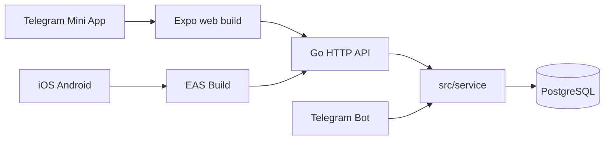

# EasyNote Frontend — Roadmap

Дорожная карта развития фронтенда в монорепозитории EasyNote. Бэкенд сейчас — Telegram-бот без HTTP API; фронт инициализирован как заготовка под TMA (web) и mobile.

## Phase 1 — Foundation (текущий этап)

- [x] Инициализация Expo + TypeScript + Expo Router в `frontend/`
- [x] Placeholder home screen
- [x] `README.md` с командами install / dev / build
- [x] `.env.example` с `EXPO_PUBLIC_API_BASE_URL`
- [x] `docs/roadmap.md`

## Phase 2 — Backend HTTP API

Бэкенд: новый слой поверх существующих сервисов, без дублирования бизнес-логики.

- [ ] Пакет `src/api/` (или `src/http/`) в Go
- [ ] Обёртка над [`src/service/reminders.go`](../../src/service/reminders.go) и связанными storage
- [ ] **Auth для TMA:** валидация Telegram WebApp `initData` (HMAC + bot token)
- [ ] **Auth для native mobile:** отдельная стратегия (OAuth, magic link, device token — TBD)
- [ ] Env-переменные бэкенда:
  - `API_PORT`
  - `CORS_ORIGINS`
  - секрет для проверки Telegram init data / JWT
- [ ] REST endpoints (ориентир — паритет с ботом):
  - reminders: list, create, update, complete, skip
  - recurring rules
  - holidays CRUD
  - shopping lists CRUD
  - user settings (timezone, intrusive reminders)
  - stats (completed / pending / skipped)

## Phase 3 — Frontend features

- [ ] Установка `@telegram-apps/sdk-react` (или `@twa-dev/sdk`) для TMA
- [ ] API client + обработка ошибок (fetch wrapper / React Query)
- [ ] Экраны по паритету с Telegram-ботом:
  - главное меню + статистика
  - напоминания (списки, календарь, создание)
  - праздники
  - списки покупок
  - настройки пользователя
- [ ] TMA UX: theme sync, BackButton, MainButton, expand viewport
- [ ] Timezone handling (как в user settings бэкенда)
- [ ] Навигация: доработать Expo Router под доменные flow

## Phase 4 — Deploy & CI

- [ ] **Docker:** static nginx-контейнер для web-бандла TMA в [`deploy/docker/`](../../deploy/docker/)
- [ ] Compose service для фронта + env `EXPO_PUBLIC_API_BASE_URL` на stage/prod
- [ ] **GitHub Actions** (отдельный job или workflow):
  ```bash
  cd frontend
  npm ci
  npm run lint
  npm run build:web
  ```
- [ ] Деплой web-статики рядом с бэкендом (beta/prod)
- [ ] **EAS Build** для iOS/Android (опционально, отдельный pipeline)

## Phase 5 — Polish

- [ ] i18n: русский UI (как в [`src/telegram/ui/texts.go`](../../src/telegram/ui/texts.go))
- [ ] E2E smoke для web (Playwright / Detox — TBD)
- [ ] Ссылка на `frontend/README.md` в корневом README
- [ ] Документация по локальной связке frontend + будущий API + docker compose

## Архитектура (целевая)



## Заметки

- Фронт **не** подключается к PostgreSQL напрямую.
- На этапе init бэкенд-файлы не менялись; deploy-скрипты — в Phase 4.
- Для локальной разработки TMA нужен HTTPS tunnel до web dev server.
